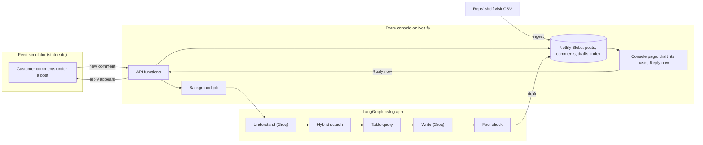
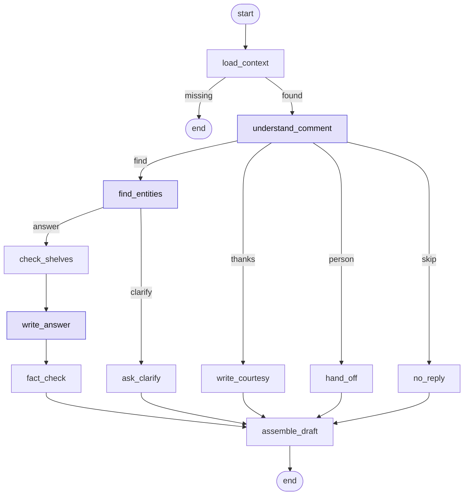

# Product Availability Reply Agent (LangGraph)

**Answering from the Data:** an AI agent that answers "where can I buy this?" comments on a brand's Instagram and Facebook posts, using the shelf visits logged by its sales reps. It names the shops that have the product, how recently a rep saw it there, and the price. A person on the marketing team approves each reply with one click.


---

## Why it matters

Customers ask the same question all day: *"Where can I find this in Irbid?"* The answer already exists in the sales reps' shelf-visit logs, but nobody on the marketing team has time to search a spreadsheet for every comment. This agent:

- **Reads the comment** in Arabic, English or a mix, including dialect and spelling variants (`وين بلاقيه بإربد؟`, `بالزرقا`, `Sweifiyeh`).
- **Finds the right product and place** with a three-way hybrid search over the catalog built from the reps' data.
- **Looks up the facts** (which shops, when a rep last saw the product on the shelf, the price) with a plain filter on the table. The model never guesses them.
- **Writes a short reply in the customer's language**, then **checks every shop, date and price** in it against the data before anyone sees it.
- **Waits for a person:** nothing is posted until someone clicks **Reply now**, edits it, or picks one of the suggested options.

## Highlights

| | |
| --- | --- |
| **Data** | 936 shelf visits cleaned into a table and a catalog of **129 entries** (products, shops, areas, cities, categories, regions) with **436 names** in Arabic and English |
| **Agent** | Two LangGraph state graphs: a **post graph** (4 nodes) that links each post to its products, and an **ask graph** (11 nodes, 3 decision points) run once per comment |
| **Search** | BM25 on words + character vectors for typos + Jina embeddings for meaning, fused with Reciprocal Rank Fusion and confidence thresholds that decide whether to answer, ask which one, or hand off |
| **Grounding** | Facts come from a table query, not from the model. A fact check rejects any reply whose shops, dates or prices do not match the data |
| **Reliability** | Strict JSON schemas, retries, rate-limit waits and a daily cap for the LLM. If any AI call fails, rules and templates take over, so every comment still gets a draft |
| **Human in the loop** | Drafts wait in a team console with the shops and visit dates behind them; one click sends the reply to the feed |
| **Tested** | 10 test suites run against a local stand-in for every AI provider. The search suite resolves **42/42** product and place names (Arabic, English, typos) with no AI at all |

## Architecture



Publishing a post runs the **post graph** (`read_post → spot_products → link_catalog → save_context`), so a question like "where do I find it?" already knows which product *it* is.

## The ask graph



Purple nodes call a model: Groq (`openai/gpt-oss-120b`) reads the comment and writes the reply, and Jina embeds the search words. Each run keeps a trace, so the console shows **how this draft was made**, node by node.

## Hybrid search

| Signal | What it catches | Detail |
| --- | --- | --- |
| BM25 | Exact words and names | k1 = 1.2, b = 0.75, with Arabic normalization (alef and hamza forms, taa marbuta, diacritics, Arabic digits) |
| Character vectors | Typos and spelling variants | 512-slot hashed character n-grams (FNV-1a), cosine similarity |
| Embeddings | Meaning and paraphrase | `jina-embeddings-v5-text-small`, 256 dimensions |
| Fusion | One ranking | Reciprocal Rank Fusion (k = 60), +0.05 for an exact name match |
| Decision | Answer, ask, or skip | Accept ≥ 0.72; consider ≥ 0.55; a clear margin of 0.08 over the runner-up, otherwise the agent asks *which one* |

Without an embedding key, the search runs on the first two signals, and the tests show it still resolves every name in the test set.

## Tech stack

| Layer | Choice |
| --- | --- |
| Agent workflow | LangGraph.js (`@langchain/langgraph`), state graphs with conditional edges |
| LLM | Groq `openai/gpt-oss-120b` with strict JSON schema output (Gemini or any OpenAI-compatible API also supported) |
| Embeddings | Jina `jina-embeddings-v5-text-small` (Gemini or OpenAI also supported) |
| Backend | Netlify Functions (12 functions, including 2 background jobs) in TypeScript |
| Storage | Netlify Blobs |
| Front end | Plain HTML, CSS and JavaScript for the team console and the feed simulator |
| Tests | `tsx` test suites with a local mock of the Groq, Jina, OpenAI and Gemini APIs |

## Repository layout

| Path | What it is |
| --- | --- |
| [`team-console/`](team-console) | The console and its backend: `src/` (ingest, hybrid search, table query, replies, the two graphs), `netlify/functions/` (the API), `public/` (the page) |
| [`feed-simulator/`](feed-simulator) | The brand's photo feed where customers comment and replies appear |
| [`tests/`](tests) | Unit tests and the local stand-in for the AI services |
| [`explorer/`](explorer) | Source of the Answer Path Explorer: it bundles the console's own modules for the browser |
| [`data/pos_availability.csv`](data/pos_availability.csv) | The sample shelf-visit data (936 visits) |
| [`docs/`](docs) | Write-up (PDF), slides (PDF and PowerPoint with speaker notes), and the explorer |

## Documentation

- **Write-up:** [`docs/Answering-from-the-Data-Document.pdf`](docs/Answering-from-the-Data-Document.pdf). Covers the answer, how it works, the graph, search, models, guardrails, testing, the options weighed, and the known gaps.
- **Slides:** [`docs/Answering-from-the-Data-Slides.pdf`](docs/Answering-from-the-Data-Slides.pdf) (22 slides), also as [PowerPoint](docs/Answering-from-the-Data-Slides.pptx).
- **Answer Path Explorer:** download [`docs/Answer-Path-Explorer.html`](docs/Answer-Path-Explorer.html) and open it in any browser. It runs the console's real code on the sample data. You can step through the three paths (the data, a post, a comment), click any graph node or edge, and type any words into the search lab. No setup is needed.

## Run it

**1. Team console.** On Netlify: **Add new project → Import an existing project →** pick this repository, and set **Base directory** to `team-console`. Build settings come from `team-console/netlify.toml`. Open `https://YOUR-SITE.netlify.app/api/health`: if it returns JSON, the functions are live.

**2. Keys (Netlify only, never in code).** Site configuration → Environment variables:

| Variable | Used for |
| --- | --- |
| `GROQ_API_KEY` | Reading comments and writing replies (free at console.groq.com) |
| `JINA_API_KEY` | Embeddings for the search (free at jina.ai) |
| `TEAM_PASSCODE` | Optional: locks the team actions behind a passcode |

Deploy again so the functions pick up the keys, then open the console → **Health** → **Test the key**. Every other setting is listed in [`team-console/README.md`](team-console/README.md).

**3. Feed simulator.** Add a second Netlify site from this repository: set **Base directory** and **Publish directory** to `feed-simulator`, with no build command. In the console: **Setup** → paste the feed address → **Save** → **Open the feed ↗**.

**4. Try it.** On the feed, pick a customer and ask under a post, for example `وين بلاقيه بإربد؟`. The draft appears in the console within seconds. Click **Reply now** and it shows on the feed.

Without any key, everything still runs: rules read the comments, templates write the replies, and the search uses words and character vectors.

## Tests

Needs Node.js 20 or newer.

```bash
cd team-console && npm install
cd ../tests && ./run-all.sh
```

`run-all.sh` starts a local stand-in for Groq, Jina, OpenAI and Gemini that checks the requests and answers with the real formats, errors and rate limits. It then runs all 10 suites: ingest, search (42 names), search with vectors, table query, replies and fact check, comment understanding, provider config, prompt size, the Groq client (schemas, retries, 429s, daily cap), and the background batch job.

To rebuild the explorer from source: `cd explorer && npm install && npm run build`. Its own test (`npm test`) checks that the browser engine gives the same search scores and drafts as the backend.

---

The shelf-visit data in this repository is a made-up sample.
